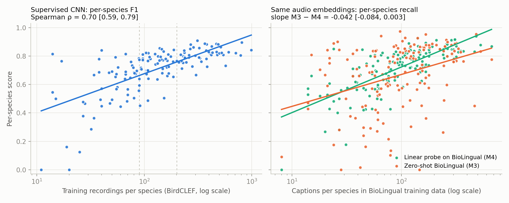

# Who Gets Heard?

**Per-species performance disparity in birdsong classification and audio-language models**

A small, pre-registered study on BirdCLEF+ 2025 (Middle Magdalena, Colombia): 145 bird species, 27,642 recordings. I compare a supervised CNN, a zero-shot audio-language model (BioLingual) and a linear probe on the same audio-language embeddings, and ask whether species with few recordings are systematically left behind, and where that disparity comes from.

*Left: the supervised CNN's per-species F1 rises with the number of training recordings. Right: on identical audio embeddings, zero-shot (orange) and a supervised linear probe (green) both favour well-recorded species, and the zero-shot slope is not steeper.*

## Findings

1. **Average accuracy hides a steep per-species gradient.** The CNN reaches 78.6% accuracy, but per-species F1 rises with log(training recordings) (Spearman ρ = 0.70 [0.59, 0.79]). The effect remains after adjusting for recordings per recordist, duration, quality rating and source. In the bottom tertile of species, recall is 0.50, against 0.83 in the top tertile.
2. **The zero-shot audio-language model shows the same pattern.** BioLingual's per-species recall rises with how often a species appears in its training captions (ρ = 0.39 [0.24, 0.52]). The pattern holds on recordings uploaded *after* its training data was collected (ρ = 0.38 [0.22, 0.53]), so memorisation does not explain it.
3. **The language route does not amplify the gap. Supervised training on imbalanced labels does** (pre-registered H3 *not supported*). On the same embeddings, the zero-shot slope is no steeper than the linear probe's (difference −0.042 [−0.084, 0.003]), and with scientific-name prompts it is significantly shallower. One explanation fits the error patterns: when supervised models are wrong, 53–72% of their errors land on the most-recorded third of species (chance: 34%); zero-shot errors do not (31–40%). For the least-recorded third, zero-shot with scientific names has the highest recall of all models (0.66 vs 0.50 for the CNN).
4. **The language route has its own weakness.** The less exposure a species has, the more its zero-shot recall depends on whether it is named by common or scientific name (ρ = −0.44 [−0.56, −0.30]; exploratory). This mirrors the long-tail knowledge problem in language models.

Example: the Blue-billed Curassow (*Crax alberti*), a Critically Endangered Colombian endemic with 20 recordings, is never recognised by the CNN (recall 0.00). Zero-shot BioLingual recognises it in 16 of 20 recordings (0.80).

## What was done

| Step | Notebook | Details |
|---|---|---|
| Inclusion, folds, leakage matching | `01-eda` | Birds with ≥ 8 recordings from ≥ 3 recordists (145 of 146 species). 5-fold `StratifiedGroupKFold` grouped by **recordist**, so no recordist appears in both training and test. |
| Features | `02_cache_features` | Up to 5 highest-energy 5 s chunks per recording, 128-bin log-mel at 32 kHz. |
| M3, M4 | `03_biolingual` | BioLingual (CLAP; `davidrrobinson/BioLingual`, rev `9d67e08`). **M3**: zero-shot with three prompts (common name / scientific name / both). **M4**: logistic regression on the same embeddings, out-of-fold. |
| M2 | `04_cnn` | ImageNet EfficientNet-B0 fine-tuned on log-mel. Epochs chosen on a recordist-grouped split inside fold 0's training data; test folds are never used for selection. |
| Analysis | `05_analysis`, `src/analysis.py` | Per-species metrics from out-of-fold predictions; bootstrap CIs over species (1,000 resamples). |

All predictions are recording-level (mean of chunk probabilities) and out-of-fold.

## Pre-registration

Hypotheses, inclusion rules, models and tests were committed in [`PREREGISTRATION.md`](PREREGISTRATION.md) (commit `bc2bc40`) before any model was evaluated. Everything else is labelled exploratory.

| | Hypothesis | Result |
|---|---|---|
| H1 | CNN per-species F1 increases with log(training recordings), also after adjustment | **Supported.** Adjusted slope 0.145 [0.094, 0.193] |
| H2 | Zero-shot recall increases with log(pretraining captions), also on unseen recordings | **Supported.** Slope 0.097 [0.058, 0.140]; unseen 0.123 [0.066, 0.192] |
| H3 | That slope is steeper for zero-shot than for a linear probe on the same embeddings | **Not supported.** Difference −0.042 [−0.084, 0.003]; unseen 0.002 [−0.055, 0.065] |
| H4 | Under-recorded species need more survey recordings to be detected | Bottom vs top tertile, CNN: P(detect) 0.50 vs 0.83 with one recording; 0.94 vs 1.00 with ten ([figure](figures/fig2_detection.png)) |

Overall (out-of-fold, 145 classes, chance = 0.7%):

| Model | Accuracy | Macro F1 | Top-5 |
|---|---|---|---|
| M2 CNN | 0.786 | 0.704 | 0.898 |
| M3 zero-shot, common name | 0.727 | 0.616 | 0.896 |
| M3 zero-shot, scientific name | 0.771 | 0.665 | 0.923 |
| M4 linear probe | 0.798 | 0.726 | 0.927 |

## Leakage

BioLingual was trained on AnimalSpeak, which draws on the same archives as BirdCLEF (Xeno-canto, iNaturalist). I matched every recording to the public AnimalSpeak file by archive ID:

- **seen** (in AnimalSpeak): 16,463 recordings (60%)
- **unseen** (uploaded after the newest AnimalSpeak ID): 5,368
- **unknown**: 5,811

Zero-shot accuracy falls from 0.75 on seen to 0.67 on unseen recordings. The linear probe, which does not use text, falls by the same amount. Within species, the seen-to-unseen recall drop is 0.105 for zero-shot and 0.104 for the probe (difference 0.001 [−0.025, 0.025]). The drop is shared by the audio side and by differences in recording mix (half of unseen recordings are from iNaturalist). It is not a language-side memorisation effect.

## Limitations

- **One exposure axis.** Training recordings and pretraining captions are almost perfectly correlated across species (ρ = 0.97), so their effects cannot be separated. H3 compares models on the same axis instead.
- **"Under-recorded" is not "rare".** Recording counts reflect where and what people record, not population size or threat status.
- **Focal recordings.** These are single-species archive recordings, not field soundscapes. Detection probabilities (H4) are an optimistic upper bound and assume independent recordings.
- **Unbalanced training by design.** M2 and M4 use plain cross-entropy without class weights, as pre-registered. Class weighting or resampling may narrow the supervised gap; that was not tested here.
- **CNN training.** Epoch selection chose the maximum (15) under a one-cycle schedule that favours the last epoch; inner-validation F1 had plateaued (0.656–0.687). One seed.
- **AnimalSpeak coverage.** The public file is the "limited" release and may be a subset of the training data; some Xeno-canto URLs lack IDs. Hence the `unknown` group.
- **Small effects, wide intervals.** Species in the bottom tertile have 11–89 recordings, and per-species estimates for them are noisy (see per-species CIs in `outputs/analysis/per_species.csv`).

## Reproduce

Notebooks 01–04 run on Kaggle; 05 runs locally on their outputs.

1. `01-eda`: inputs are the `birdclef-2025` competition data and a dataset with `data/animalspeak_*` (from `python src/exposure.py` on `AnimalSpeak_limited.csv`). Outputs go to `outputs/eda/`.
2. `02_cache_features` (CPU): inputs are the competition data and the EDA outputs.
3. `03_biolingual` (GPU, internet): inputs are the competition data, the EDA outputs and the 02 output. Download results to `cache/biolingual/`.
4. `04_cnn` (GPU, internet): inputs are the EDA outputs and the 02 output. Download results to `cache/cnn/`.
5. `05_analysis`: run locally. It writes `outputs/analysis/` and `figures/`.

Run 01–04 with *Save Version → Save & Run All* so that outputs persist.

## Data and licences

- **BirdCLEF+ 2025** audio and metadata are subject to the competition rules and are not redistributed here. The recordings carry their original Creative Commons licences.
- **AnimalSpeak** (CC BY-NC-SA 4.0): only per-species counts and archive IDs derived from it are included.
- **Code**: see `LICENSE` (to be added).

## References

- Robinson et al. (2023). *Transferable Models for Bioacoustics with Human Language Supervision* (BioLingual, AnimalSpeak). arXiv:2308.04978
- Udandarao et al. (2024). *No "Zero-Shot" Without Exponential Data.* NeurIPS. arXiv:2404.04125
- Parashar et al. (2024). *The Neglected Tails in Vision-Language Models.* CVPR. arXiv:2401.12425
- Kandpal et al. (2023). *Large Language Models Struggle to Learn Long-Tail Knowledge.* ICML. arXiv:2211.08411
- *An inadequate sampling of the soundscape leads to over-optimistic estimates of recogniser performance.* Bioacoustics (2024).
- BirdCLEF+ 2025, LifeCLEF / Kaggle.
